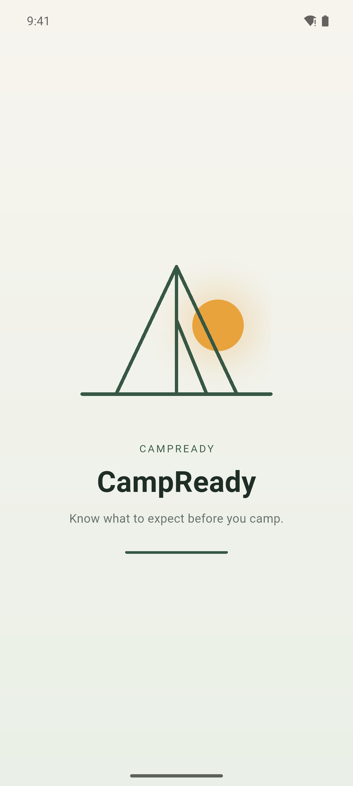
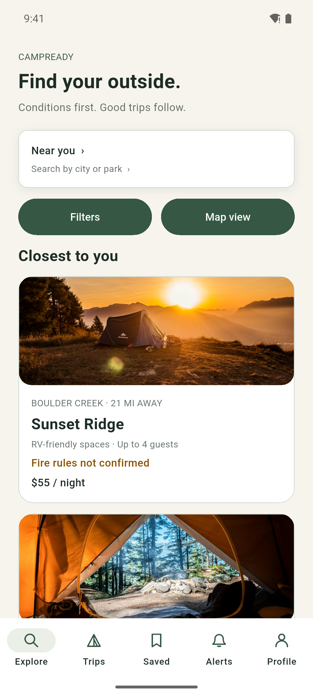
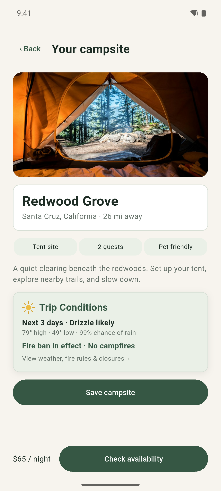
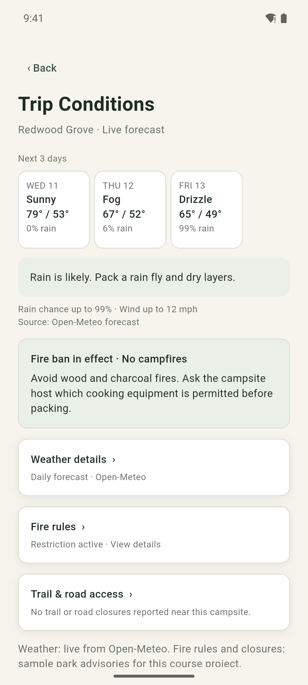
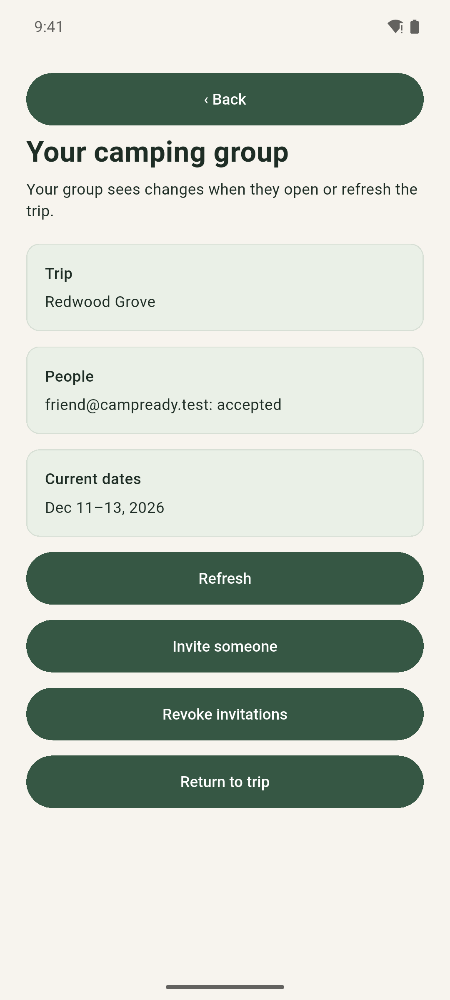
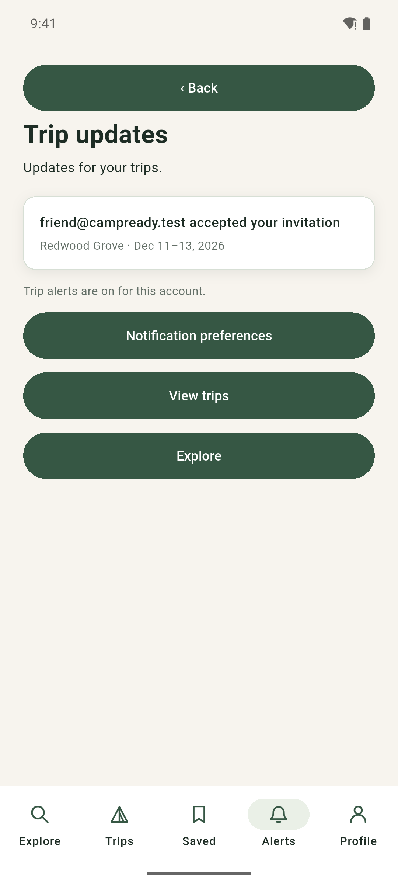

# CampReady

**Know what to expect before you camp.**

CampReady helps weekend campers pick a campsite, check live conditions, and plan the trip with their group in one place. It is the CSEN 268 (Fall 2026) final project of Group 2: Atishay Jain and Alexander Shirazi.

- Live web app: https://campready-group2.web.app
- Platforms: Web, Android, iOS (Flutter)
- Design: [Figma file](https://www.figma.com/design/0fq2beCEORwCjxxgzTkmFA/CampReady)

| | | |
| --- | --- | --- |
|  |  |  |
|  |  |  |

## The problem

Campers juggle several sites before a trip: a booking page, a weather app, the park's fire notices, and a group chat to agree on dates. Conditions change after plans are made, and not everyone in the group hears about it.

**Target users:** people who camp a few weekends a year, often with friends or family, mostly within a few hours' drive.

CampReady puts the campsite, the live forecast, fire rules and road access next to the trip itself, lets the owner share the trip with the group, and sends everyone a push when something changes.

## Features

| Area | What the app does |
| --- | --- |
| Authentication | Email sign-up and sign-in with Firebase Auth, field validation, readable errors, password-reset email, session kept across restarts, sign-out removes the device's push token. |
| Sensors: GPS | "Use my location" asks for permission, reads the position with `geolocator`, and sorts campsites by distance ("0.1 mi away"). Denied, permanently denied and location-services-off each show a clear fallback to searching by destination. |
| Sensors: camera | Take or choose a profile photo with `image_picker`. It is resized to a small JPEG and stored on the user's Firestore document. Camera denial and cancelling are handled. |
| Data services | Cloud Firestore for profiles, saved campsites, trips, invitations, responses and notifications, protected by security rules. Live forecasts come from the Open-Meteo API. |
| Messaging | Firebase Cloud Messaging. Two Cloud Functions send user-specific pushes: an invitee gets one when a trip is shared or its dates change, and the owner gets one when an invitee accepts or declines. Users who turn alerts off get none. Tapping a notification opens the trip. |
| Trip planning | Real date picker (no past dates, checkout after arrival, up to 14 nights), price total, simulated booking request, edit dates, offline summary (Plus). |
| Group sharing | Invite by email, accept or decline, owner sees each answer, revoke access. Invitees get a view-only version of the trip. |
| Routing | GoRouter with readable web URLs (`/campsite/redwood-grove`, `/trips/<id>`), deep links, an auth gate that returns you to the link, and all 100 named routes from the design. See [docs/ROUTES.md](docs/ROUTES.md). |
| Animated splash | The tent draws itself, the sun rises behind it and the name slides in (staggered explicit animation), then the app opens the right screen. |

### Monetization

The basics stay free: browsing, live conditions, one trip with your group, and push alerts. **CampReady Plus ($2.99/month)** adds multiple trips at once and offline trip summaries. In this project the Plus checkout is simulated and never charges. Future revenue could come from campground booking referrals.

### What is simulated

- Booking requests and the Plus upgrade are simulated. No payment is taken, and the screens say so.
- Fire rules and trail closures are sample park advisories for the two catalog campsites. The weather forecast is live.

## Architecture

```
UI (screens + DesignScreen)
  │  BlocBuilder / context.watch, BlocListener
  ▼
Blocs and Cubits ── AuthBloc, NotificationsBloc
                    TripsCubit, SavedCubit, ProfileCubit,
                    ExploreCubit, BookingCubit
  │
  ▼
Repositories (RepositoryProvider)
  AuthRepository · TripRepository · CampsiteRepository · ProfileRepository
  NotificationRepository · LocationRepository · WeatherRepository · PhotoRepository
  │
  ▼
Services: Firebase Auth · Cloud Firestore · Firebase Messaging · geolocator · image_picker · http (Open-Meteo)

Cloud Functions (functions/index.js)
  pushTripNotification  trips/{tripId}/notifications/{id} created → push to invitees
  pushInviteResponse    trips/{tripId}/responses/{uid} written   → push to the owner
```

- **State management:** `flutter_bloc`. `AuthBloc` and `NotificationsBloc` use events (the class pattern from the lectures). The other features use Cubits with immutable `Equatable` states. `NotificationsBloc` registers the FCM `onMessage` and `onMessageOpenedApp` listeners and the launch message, and the app shows incoming pushes through a `BlocListener`.
- **Routing:** `lib/router.dart`. A `refreshListenable` built from the auth and trips streams re-checks redirects when the session or trip list changes.
- **Push targets:** like the class `NotificationsBloc`, the app asks for notification permission when a signed-in user has alerts on, calls `FirebaseMessaging.register()`, and saves the device's Firebase Installation ID (FID) under `users/{uid}/fcmTokens`. The functions look recipients up by email with the Admin SDK, send to their FIDs, skip users with alerts off, and remove FIDs that FCM reports as gone. Each push carries the id of its saved notice, so a push and its notice show as one alert.
- **Local mode:** the same repositories run on an in-memory store for tests and offline previews (`--dart-define=LOCAL_DEMO=true`).

```
lib/
  app.dart            providers, account listeners, MaterialApp.router
  router.dart         GoRouter: paths, redirects, deep links
  blocs/              auth, booking, explore, notifications, profile, saved, trips
  repositories/       one class per data source
  services/           Firebase and local implementations
  models/             Campsite, Stay (dates)
  screens/            screen layouts, DesignScreen, animated splash
functions/            Cloud Functions for push
test/                 bloc_test, repository and widget tests
tool/                 screenshot generator
```

## Run it

Requirements: Flutter 3.47 or newer (Dart 3.13), Xcode for iOS, Android Studio for Android.

```sh
flutter pub get
flutter run -d chrome          # web
flutter run -d emulator-5554   # Android emulator
flutter run -d "iPhone 17 Pro" # iOS Simulator
```

The app uses the Firebase project `campready-group2` on all three platforms.

### Tests

```sh
flutter analyze
flutter test
flutter test integration_test/app_test.dart -d emulator-5554   # on a device or emulator
```

There are 238 tests:

- `bloc_test` tests for every Bloc and Cubit.
- Repository tests with `mocktail`.
- Widget flows: sign-up, booking with the date picker, sharing, camera, location, and sync.
- A test that renders all 100 routes and checks that no prototype text is shown.
- An on-device integration test: sign up, search, pick dates, book, open the trip.

### Local Firebase emulators

```sh
firebase emulators:start --only auth,firestore,functions
flutter run -d chrome --dart-define=USE_FIREBASE_EMULATORS=true
# Android emulator: add --dart-define=EMULATOR_HOST=10.0.2.2
```

The functions use `firebase-admin` 14 and need Node 22 on your machine. FCM is not emulated, so pushes from the local functions reach real devices.

### Deploy

```sh
firebase deploy --only firestore:rules --project campready-group2
flutter build web && firebase deploy --only hosting --project campready-group2
cd functions && npm install && cd .. && firebase deploy --only functions --project campready-group2
```

Cloud Functions need the project on the Blaze (pay-as-you-go) plan; usage for this app stays within the free quota.

### Push on each platform

- **Web and Android:** FCM works with the files in this repo (`web/firebase-messaging-sw.js`, `android/app/google-services.json`, and the `firebase_messaging_installation_id_enabled` flag in the Android manifest). Android 13+ asks for notification permission after sign-in when alerts are on.
- **iOS:** push needs an APNs key from a paid Apple Developer account, uploaded in Firebase → Project settings → Cloud Messaging. Without it the app runs normally and says push is not set up on that iPhone.

## Documents

- [Routes and screenshots](docs/ROUTES.md)
- [App Store listing](docs/STORE_LISTING.md)
- [Presentation outline](docs/PRESENTATION.md)
- [Video script](docs/DEMO_SCRIPT.md)
- [Contributions](docs/CONTRIBUTIONS.md)
- [First Integrations milestone](docs/FIRST_INTEGRATIONS.md)
