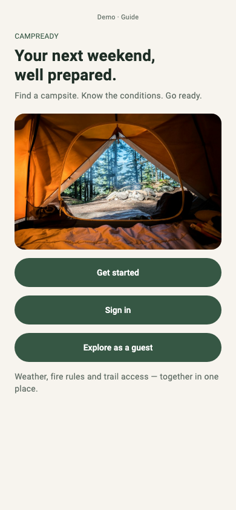
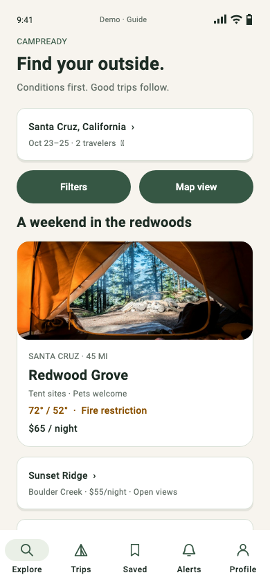

# CampReady

Know what to expect before you camp.

CSEN 268 · Group 2 · Atishay Jain and Alexander Shirazi

Flutter implementation of the **Coded UI of the App** milestone: screens,
Material theme, interactive controls, and named routes based on our submitted
CampReady Figma design.

## Run

Requires Flutter 3.47.5 / Dart 3.13.4 or a compatible newer stable SDK.

```sh
flutter pub get
flutter run -d chrome
```

Run on a connected Android or iOS device with `flutter run`. iOS requires Xcode;
Android requires the Android SDK. The web build runs without API keys.

```sh
flutter analyze
flutter test
flutter build web
```

## Screens and navigation

All **100 Figma frames** have named routes, including the walkthrough guide,
loading/splash variants, and alternative outcomes. [Full route inventory and
screenshots](docs/ROUTES.md). No frame is omitted from the route inventory.

Main flow: animated splash → welcome → guest Explore → campsite → conditions
→ account gate → signup → location demo → Explore → campsite → dates → review
→ simulated booking → trip → share → invitation → accept/decline.

The five tabs are Explore, Trips, Saved, Alerts and Profile. Filters, illustrative
map pins, saved campsites, profile edits, notifications, Plus upgrade/cancellation,
booking outcomes, date error examples, invitation expiry and offline snapshots
are connected. Open **Demo · Guide** from the top of any screen to inspect the
walkthrough or select any prototype screen.




## Milestone boundaries

All data and services are **simulated**. Bookings, accounts, emails, notification
permissions, location permissions, payments and downloads do not contact real
services. No charge is made. Demo state lives in memory and resets on restart;
offline summaries are session previews, not persistent downloads. The map is
illustrative. Dates and forecasts are fixed sample scenarios from the design.

The one-pager's proposed Plus price is **$2.99/month**. Core browsing, conditions
and essential alerts stay free. The later integration milestone will connect
Firebase Auth, Firestore, FCM, device location and live conditions feeds.

## Design sources

- [Submitted Figma design](https://www.figma.com/design/0fq2beCEORwCjxxgzTkmFA/CampReady)
- Submitted CampReady App One Pager and Hipcamp HW1 review, supplied project pack.
- Roboto; forest `#365744`, warm white `#F7F4EE`, soft green `#EAF0E7`, amber notices.
- Campsite photos, map layers and navigation graphics are downloaded original
  Figma assets. Roboto is bundled locally with its license.

The live file contained 100 top-level frames when implemented. Detailed exports
were available for 71 frames before the Figma Education-plan tool limit; the
remaining 29 use directly read Figma text/layout blocks and the supplied route
and theme specification. Native Flutter layout adapts the design to scrolling,
editable fields and screen width; screenshots document the coded result.

## Verification and submission

128 passing tests walk signup, booking, sharing, five-tab navigation, filters, profile
validation, Plus and offline previews. Regression checks cover both campsites
through Back navigation, sharing, removal and restored browser routes. Each route is rendered at 390 × 844 with
layout exceptions checked. [Screenshots](docs/screenshots) are actual Flutter
renders of the coded screens, not Figma exports.

Regenerate screenshots explicitly:

```sh
flutter test --dart-define=SCREENSHOTS=true --update-goldens
```

Create a new tag for this revision before submitting the repository, or submit
the screenshots as permitted by the assignment. **coded-ui-v1.2** identifies the
earlier UI snapshot. This repository does not submit anything to Camino.

## Code layout

- `lib/theme.dart`: Material colors, typography and control styles.
- `lib/app.dart`: named routes, session state, interactive screens and controls.
- `lib/screens/` contains the Flutter layouts grouped by feature and the list of named routes.
- `lib/screens.dart` contains the buttons, cards and text styles shared by those screens.
- `assets/images`: local design assets; no temporary Figma URLs at runtime.
- `test/app_test.dart`: navigation, input validation and screen rendering checks.
